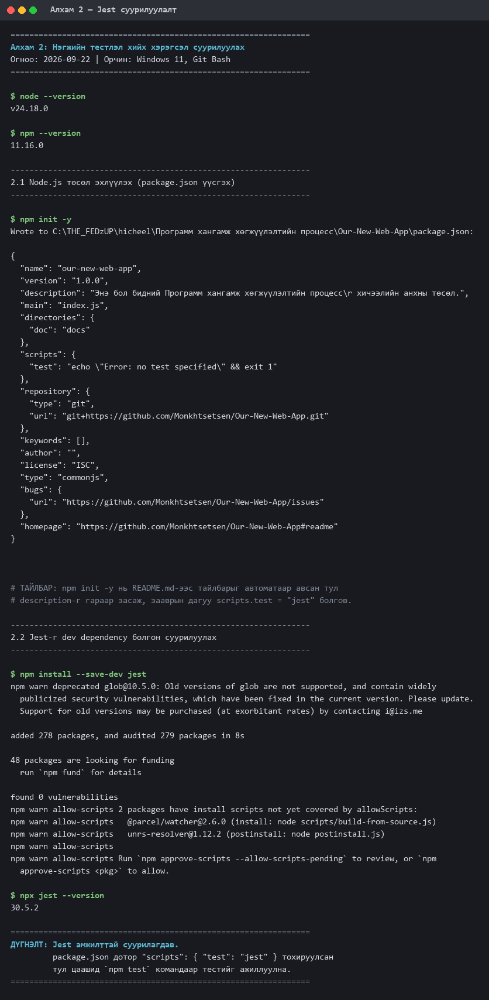
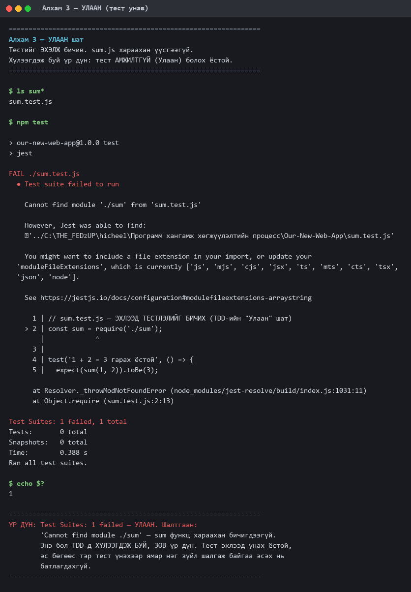
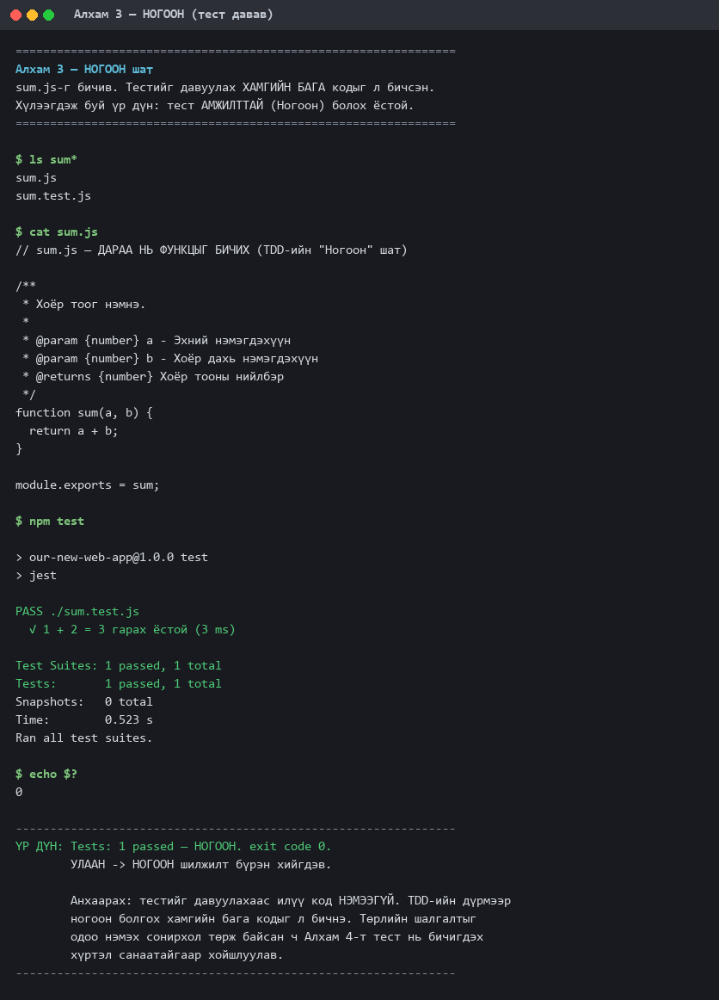
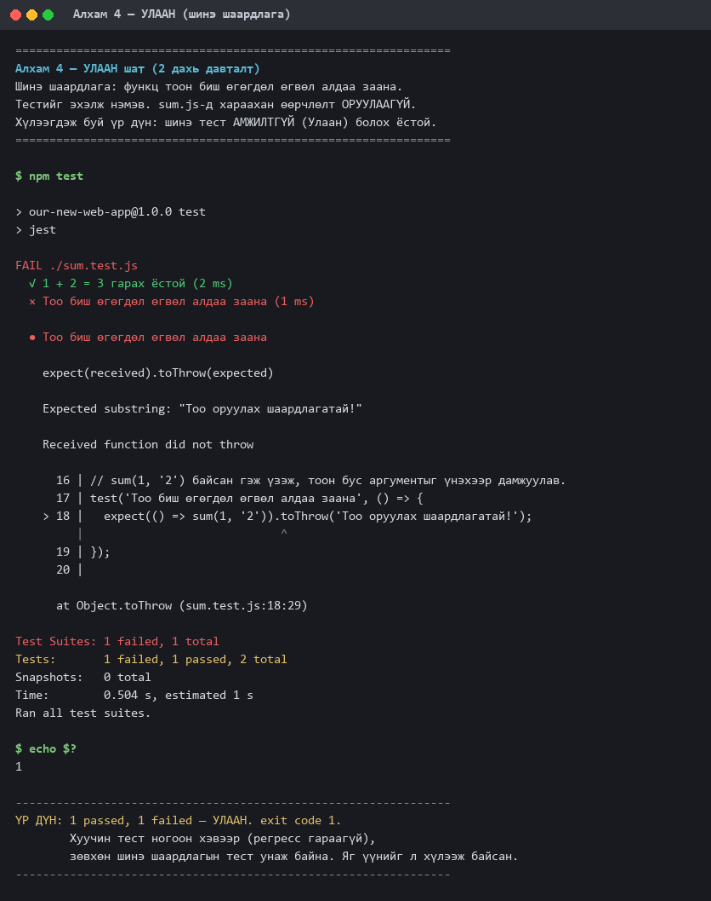
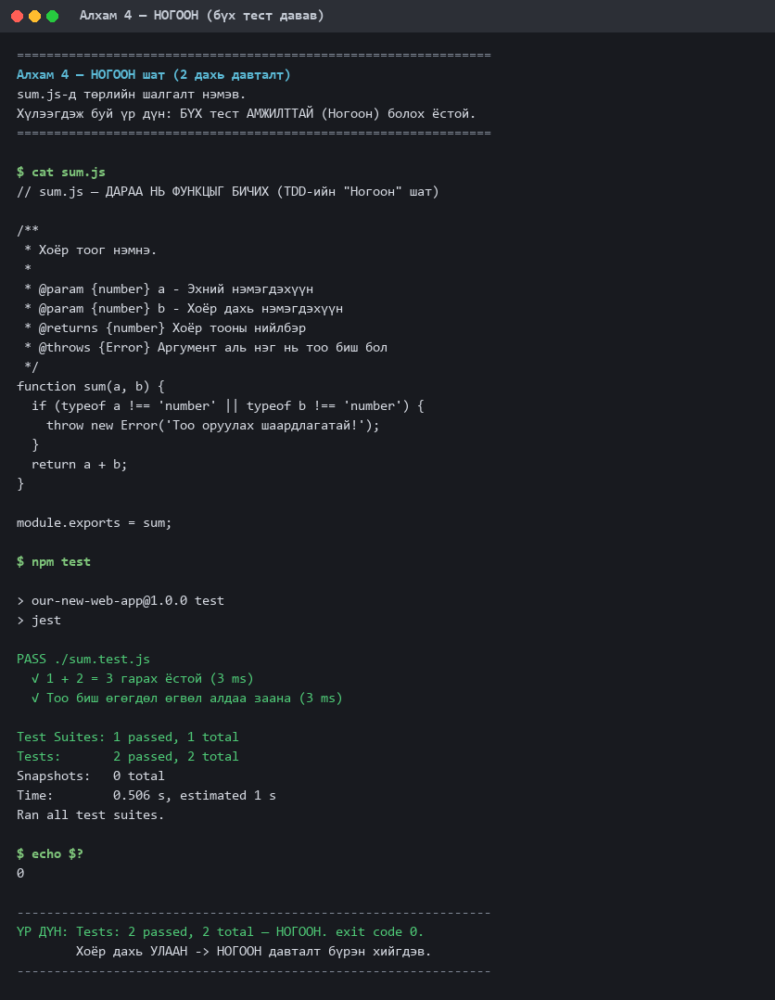
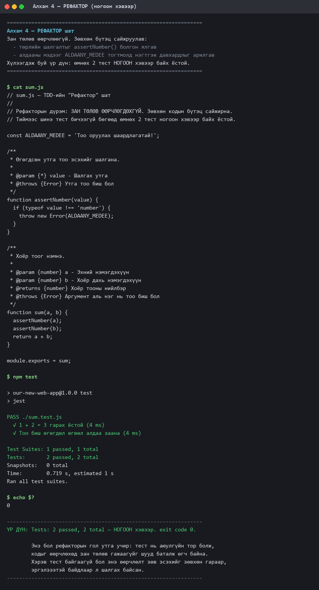
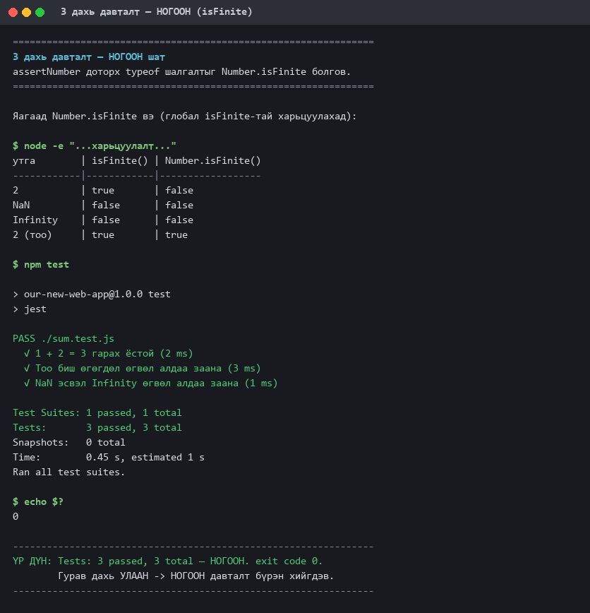
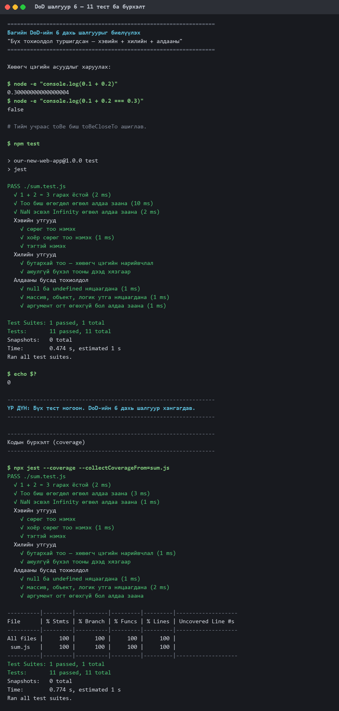

# Лабораторийн ажил №4 — Тайлан

## Definition of Done (DoD) ба Нэгжийн Тестлэл

| | |
|---|---|
| **Хичээл** | Программ хангамж хөгжүүлэлтийн процесс |
| **Сэдэв** | 4-р долоо хоног: Sprint-ийн эхлэл, нэгж тестлэл ба TDD-ийн үндэс |
| **Төсөл** | Бидний анхны төсөл — AI-д суурилсан зорилго ба дадал хөтлөгч веб апп |
| **Repo** | `Monkhtsetsen/Our-New-Web-App` |
| **Салбар** | `feature/lab04-tdd` (үндсэн салбар `main`-аас салгасан) |
| **Гүйцэтгэсэн** | И.Эрдэнэбаяр /B232270136/ — Хөгжүүлэгч |
| **Огноо** | 2026-09-22 |

---

## 1. Зорилго

- "Definition of Done" (DoD) гэж юу вэ, яагаад чухал болохыг ойлгох
- Нэгжийн тестлэл (Unit Testing) хийх чадвар эзэмших
- Test-Driven Development (TDD) давталтын үндсийг ойлгох, дадлагажуулах
- Хөгжүүлэлтийн орчинд шаардлагатай хэрэгслүүдийг суурилуулах

## 2. Хэрэглэсэн хэрэгсэл

| Зүйл | Хувилбар |
|---|---|
| Үйлдлийн систем | Windows 11 Pro |
| Терминал | Git Bash |
| Node.js | v24.18.0 |
| npm | 11.16.0 |
| Туршилтын framework | **Jest 30.5.2** |
| Засварлагч | VS Code |

Заавар Jest (JavaScript), pytest (Python), JUnit (Java) гурвыг санал болгосон.
Зааврын үндсэн жишээ Jest дээр бичигдсэн бөгөөд манай багийн төсөл вэб апп тул
**JavaScript + Jest**-ийг сонгов.

---

## 3. Төслийн бүтэц

```
Our-New-Web-App/
├── sum.js                      # Хөгжүүлсэн функц
├── sum.test.js                 # Нэгж туршилтууд (11 тест)
├── jest.config.js              # Jest тохиргоо
├── package.json                # scripts.test = "jest"
├── docs/
│   ├── DoD.md                  # Багийн Definition of Done (v1.1)
│   ├── lab04-report.md         # Энэ тайлан
│   └── screenshots/            # Шат бүрийн дэлгэцийн зураг (9 ш)
└── results/                    # Терминалын БОДИТ гаралт (9 файл)
```

`results/` доторх текст файлууд нь терминалаас шууд бичигдсэн эх гаралт,
`docs/screenshots/` доторх зургууд нь тэдгээрийг дүрсэлсэн хувилбар. Хоёуланг нь
тулгаж шалгах боломжтой.

---

## 4. Алхам 1 — "Definition of Done" гэж юу вэ?

Дэлгэрэнгүйг [`docs/DoD.md`](DoD.md)-аас үзнэ үү.

### Хэлэлцүүлгийн гол дүгнэлт

"Ажил дууссан гэж хэзээ хэлэх вэ?" гэсэн асуултад багийн гишүүд эхэндээ өөр өөр
хариулт өгсөн: "код бичиж дуусахад", "миний компьютер дээр ажиллахад", "push
хийхэд". Эдгээрийг задлан шинжилсний дараа нийтлэг сул тал нь илэрсэн —
**бүгд нь субьектив бөгөөд шалгах арга нь тодорхойгүй**.

> **Багийн тодорхойлолт:** "Дууссан" гэдэг нь хүн бүрийн мэдрэмж биш, баг даяар
> нэг ижил ойлгогддог, гуравдагч хүн шалгаж чадахуйц шалгуурын жагсаалт юм.

Эндээс практик дүрэм гарч ирэв: **хэрэв нэг шалгуурыг хоёр өөр гишүүн шалгаад
өөр дүгнэлтэд хүрч байвал тэр шалгуур буруу бичигдсэн.** Тиймээс DoD-ийн шалгуур
бүрд "хэрхэн шалгах вэ" ба "хариуцагч" гэсэн багана заавал нэмэхээр тохиролцов.

### Багийн DoD v1.0 (хураангуй)

9 шалгуур батлагдсан: код бичигдсэн → нэгж тестлэлд давсан → шинэ функц тесттэй
→ code review хийгдсэн → бичлэгийн дүрэм дагасан → бүх тохиолдол туршигдсан →
баримтжуулсан → integration туршилт → үндсэн салбар эвдрээгүй.

Энэ жагсаалтыг **багийн ажлын гэрээ** гэж үзэж, аль нэг шалгуур хангагдаагүй бол
ажил Scrum самбарын "Дууссан" баганад шилжихгүй гэж тогтов.

---

## 5. Алхам 2 — Хэрэгсэл суурилуулах

```bash
npm init -y                    # package.json үүсгэх
npm install --save-dev jest    # Jest-г dev dependency болгох
```

`package.json` дотор зааврын дагуу script нэмэв:

```json
"scripts": {
  "test": "jest"
}
```

**Үр дүн:** Jest 30.5.2 суурилагдав (278 багц, 0 vulnerability).

**Тулгарсан асуудал ба шийдэл.** Jest 30 дээр терминал TTY биш үед (гаралтыг
файл руу дамжуулахад) `PASS` мөр болон тест бүрийн нэр хэвлэгддэггүй, зөвхөн
хураангуй үлддэг байв. Тайланд нотолгоо хадгалах шаардлагатай тул
`jest.config.js` үүсгэж `reporters: ['default']`, `verbose: true`-г ил заав.

> Нотолгоо: [`results/01-setup.txt`](../results/01-setup.txt) ·
> 

---

## 6. Алхам 3 — Энгийн функц ба түүний нэгж туршилт

### 6.1 УЛААН — тестийг эхлээд бичив

`sum.test.js`-г эхэлж үүсгэв. `sum.js`-г **санаатайгаар үүсгээгүй**.

```javascript
const sum = require('./sum');

test('1 + 2 = 3 гарах ёстой', () => {
  expect(sum(1, 2)).toBe(3);
});
```

```
FAIL ./sum.test.js
  ● Test suite failed to run
    Cannot find module './sum' from 'sum.test.js'

Test Suites: 1 failed, 1 total
exit code: 1
```

Энэ бол **хүлээгдэж буй, зөв үр дүн**. Тест эхлээд унахгүй бол тэр тест үнэхээр
ямар нэг зүйл шалгаж байгаа эсэхийг батлах боломжгүй.

> Нотолгоо: [`results/02-red-1.txt`](../results/02-red-1.txt) ·
> 

### 6.2 НОГООН — функцыг дараа нь бичив

```javascript
function sum(a, b) {
  return a + b;
}
module.exports = sum;
```

```
PASS ./sum.test.js
  √ 1 + 2 = 3 гарах ёстой (3 ms)

Tests: 1 passed, 1 total
exit code: 0
```

**Анхаарсан зүйл:** тестийг давуулахаас илүү код нэмээгүй. Төрлийн шалгалт нэмэх
сонирхол тэр дор нь төрсөн ч, түүний тест Алхам 4-т бичигдэх хүртэл
санаатайгаар хойшлуулав — TDD-д тестгүй код бичихгүй.

> Нотолгоо: [`results/03-green-1.txt`](../results/03-green-1.txt) ·
> 

---

## 7. Алхам 4 — TDD давталтыг бүрэн гүйцэтгэх

**Шинэ шаардлага:** функц тоон биш өгөгдөл өгвөл алдаа заана.

### 7.1 УЛААН

```javascript
test('Тоо биш өгөгдөл өгвөл алдаа заана', () => {
  expect(() => sum(1, '2')).toThrow('Тоо оруулах шаардлагатай!');
});
```

```
FAIL ./sum.test.js
  √ 1 + 2 = 3 гарах ёстой (2 ms)
  × Тоо биш өгөгдөл өгвөл алдаа заана (1 ms)

    Expected substring: "Тоо оруулах шаардлагатай!"
    Received function did not throw

Tests: 1 failed, 1 passed, 2 total
exit code: 1
```

Хуучин тест ногоон хэвээр байгаа нь **регресс гараагүйг** харуулж байна.

> ⚠️ **Зааврын зөрүүг анзаарсан нь.** Лабораторийн PDF дээр энэ тест
> `expect(() => sum(1, 2)).toThrow(...)` гэж хэвлэгдсэн байв. Гэвч `1` ба `2`
> хоёулаа тоо тул функц хэзээ ч алдаа шидэхгүй — энэ хэлбэрээр бичвэл тест
> ногоон болох боломжгүй. PDF-ээс хашилтын тэмдэг алга болсон нь илэрхий:
> мөн адил `require(./sum)`, `typeof a !== number`, `test(1 + 2 = 3 гарах
> ёстой, ...)` гэж хэвлэгдсэн. Тиймээс эх хувилбар нь `sum(1, '2')` байсан гэж
> үзэж, тоон бус аргументыг үнэхээр дамжуулав.

> Нотолгоо: [`results/04-red-2.txt`](../results/04-red-2.txt) ·
> 

### 7.2 НОГООН

```javascript
function sum(a, b) {
  if (typeof a !== 'number' || typeof b !== 'number') {
    throw new Error('Тоо оруулах шаардлагатай!');
  }
  return a + b;
}
```

```
PASS ./sum.test.js
  √ 1 + 2 = 3 гарах ёстой (3 ms)
  √ Тоо биш өгөгдөл өгвөл алдаа заана (3 ms)

Tests: 2 passed, 2 total
exit code: 0
```

> Нотолгоо: [`results/05-green-2.txt`](../results/05-green-2.txt) ·
> 

### 7.3 РЕФАКТОР

Заавар "энэ жишээнд рефактор хийх шаардлагагүй" гэсэн. Гэвч рефакторын дүрмийг
практикаар харуулах зорилгоор жижиг сайжруулалт хийв:

- төрлийн шалгалтыг `assertNumber()` туслах функц болгон ялгав
- алдааны мэдээний давхардлыг `ALDAANY_MEDEE` тогтмолд нэгтгэв

**Хамгийн чухал зүйл: шинэ тест нэмээгүй, өмнөх 2 тест ногоон хэвээр үлдэв.**

```
Tests: 2 passed, 2 total
exit code: 0
```

Энэ бол рефакторын гол утга учир — тест нь **аюулгүйн тор** болж, кодын бүтцийг
өөрчлөхөд зан төлөв гажаагүйг шууд баталж өгч байна. Хэрэв тест байгаагүй бол
энэ өөрчлөлт зөв эсэхийг зөвхөн гараар, эргэлзээтэй байдлаар л шалгах байсан.

> Нотолгоо: [`results/06-refactor.txt`](../results/06-refactor.txt) ·
> 

---

## 8. Нэмэлт — 3 дахь давталт (рефактор хийх явцад илэрсэн алдаа)

Рефактор хийж байх үед JavaScript-ийн нэг чухал онцлог анзаарагдав:

```
typeof NaN      = number
typeof Infinity = number
```

Өөрөөр хэлбэл одоогийн шалгалт эдгээрийг "тоо" гэж үзэн нэвтрүүлж,
`sum(NaN, 1)` нь алдаа шидэхгүйгээр `NaN`-г **чимээгүй** буцаана.

**Төслийн хувьд эрсдэл:** манай апп-д XP, Level, Streak-ийн тооцоололд `NaN` нэг
удаа орвол хэрэглэгчийн өгөгдөл бүхэлдээ гажиж, буцаан засахад хэцүү болно.

> **TDD-ийн дүрэм чухал үүрэг гүйцэтгэсэн мөч.** Үүнийг рефактор дотор шууд
> засах уруу таталт байсан. Гэвч энэ нь **шинэ зан төлөв** тул рефактор биш.
> Рефактор нь зан төлвийг өөрчлөхгүй. Тиймээс эхлээд тест бичиж улаан болгов.

**УЛААН:**

```javascript
test('NaN эсвэл Infinity өгвөл алдаа заана', () => {
  expect(() => sum(NaN, 1)).toThrow('Тоо оруулах шаардлагатай!');
  expect(() => sum(1, Infinity)).toThrow('Тоо оруулах шаардлагатай!');
});
```
→ `Tests: 1 failed, 2 passed, 3 total` · exit code 1

**НОГООН:** `typeof` шалгалтыг `Number.isFinite`-аар сольсон.

| утга | `isFinite()` | `Number.isFinite()` |
|---|---|---|
| `'2'` | true | **false** |
| `NaN` | false | false |
| `Infinity` | false | false |
| `2` | true | true |

Глобал `isFinite` нь аргументаа тоо руу **хөрвүүлдэг** тул `'2'` мөрийг
нэвтрүүлнэ. `Number.isFinite` хөрвүүлэлт хийдэггүй тул гурван тохиолдлыг нэг
шалгалтаар хамарч, өмнөх 2 тест ч ногоон хэвээр үлдэв.

→ `Tests: 3 passed, 3 total` · exit code 0

> Нотолгоо: [`results/07-red-3.txt`](../results/07-red-3.txt),
> [`results/08-green-3.txt`](../results/08-green-3.txt) ·
> 

---

## 9. DoD-г шалгах хуудас болгон ашигласан нь

Багийн DoD-ийн 6 дахь шалгуур: *"Бүх тохиолдол туршигдсан — хэвийн утга +
хилийн утга + алдааны тохиолдол гурвуулан бичигдсэн."*

Гурван тест зөвхөн **алдааны** тохиолдлыг л сайн хамарч байсныг DoD илрүүлэв.
Дутууг нөхөж тестийг **3-аас 11** болгон өргөтгөв:

| Бүлэг | Тестүүд |
|---|---|
| Хэвийн утгууд | сөрөг тоо, хоёр сөрөг тоо, тэгтэй нэмэх |
| Хилийн утгууд | бутархай (хөвөгч цэг), `MAX_SAFE_INTEGER` |
| Алдааны тохиолдол | `null`/`undefined`, массив/объект/логик утга, аргументгүй дуудалт |

**Хөвөгч цэгийн тэмдэглэл:** `0.1 + 0.2 = 0.30000000000000004` тул `toBe(0.3)`
унана. `toBeCloseTo` ашиглаж, `not.toBe(0.3)`-оор энэ зан төлвийг ил
баримтжуулав.

**Эцсийн үр дүн:**

```
Tests: 11 passed, 11 total

----------|---------|----------|---------|---------|
File      | % Stmts | % Branch | % Funcs | % Lines |
----------|---------|----------|---------|---------|
 sum.js   |     100 |      100 |     100 |     100 |
----------|---------|----------|---------|---------|
```

> Нотолгоо: [`results/09-dod-coverage.txt`](../results/09-dod-coverage.txt) ·
> 

---

## 10. Алхам 5 — Нэгжийн тестлэлийг DoD-д албажуулав

v1.0 дээр "Код нэгжийн тестлэлд давсан" гэсэн мөр байсан ч **хэмжиж болохооргүй**
байв — "давсан" гэдгийг хэн, юугаар шалгах нь тодорхойгүй. Лабораторийн ажлаас
олж мэдсэнээ тусган **DoD v1.1** гаргав:

| Өөрчлөлт | Агуулга |
|---|---|
| Шалгуур 2 хүчитгэв | "давсан" → `npm test` → бүх тест ногоон, `exit code 0`, алгассан тест байхгүй |
| Шалгуур 3 нэмэв | Функц ба түүний тест **нэг PR дотор хамт** ирнэ |
| Шалгуур 4 нэмэв | Тест **эхлээд унаж байсан** нь commit-ийн түүх эсвэл `results/`-д батлагдсан байх |
| Шалгуур 7 тодруулав | Хэвийн + хилийн + алдааны тохиолдол гурвуулан |

Шалгуур 4 бол лабораторийн хамгийн чухал сургамж: хэзээ ч унахгүй тест нь
хэзээ ч ногоон болохгүй тесттэй адил хэрэггүй.

**Багт юу гэсэн үг вэ:** энэ мөчөөс эхлэн нэгжийн тестлэл нь "цаг гарвал хийх
нэмэлт ажил" биш, багийн бүх гишүүний ажлын салшгүй хэсэг болов.

---

## 11. TDD-ийн "Улаан → Ногоон → Рефактор" — дүгнэлт

| Шат | Зорилго | Дүрэм |
|---|---|---|
| 🔴 **Улаан** | Унах тест бичих | Тест **заавал унах** ёстой. Унахгүй бол тэр тест юу ч шалгахгүй байна гэсэн үг. |
| 🟢 **Ногоон** | Тестийг давуулах | Давуулах **хамгийн бага** кодыг л бичнэ. Илүү код = тестгүй код. |
| 🔵 **Рефактор** | Бүтцийг сайжруулах | Зан төлөв **өөрчлөгдөхгүй**. Шинэ тест нэмэхгүй, хуучин тестүүд ногоон хэвээр. |

### Энэ лабораас практикаар ойлгосон зүйл

**1. Улаан шат бол тестийн тест юм.**
Тест эхлээд унаж байж л тэр тест үнэхээр ямар нэг зүйл шалгаж байгаа нь
батлагдана. Зааврын PDF дээрх `sum(1, 2)` хувилбар нь яг үүний эсрэг жишээ —
хэзээ ч ногоон болохгүй тест.

**2. Рефактор ба шинэ функц хоёрыг хольж болохгүй.**
`NaN`-ийн асуудлыг рефактор дотор чимээгүй засах уруу таталт байсан. Тэгсэн бол
"рефактор" нэрийн дор тестгүй зан төлөв нэвтрэх байв. Үүний оронд тусад нь
Улаан → Ногоон давталт хийсэн нь commit-ийн түүхэнд ил харагдаж байна.

**3. Тест нь аюулгүйн тор.**
`assertNumber` ялгах болон `typeof` → `Number.isFinite` солих хоёр өөрчлөлтийг
зоригтой хийж чадсан шалтгаан нь тестүүд байсан. Тестгүй бол ийм өөрчлөлт
бүрийг гараар, эргэлзээтэй шалгах байсан.

**4. DoD нь зүгээр нэг жагсаалт биш, ажлын хэрэгсэл.**
DoD-ийн 6 дахь шалгуурыг шалгах хуудас болгон ашигласнаар тестийн хамралт
дутуу байгаа нь илэрч, 3 тест 11 болж өргөжив. Жагсаалтыг бичээд тавьчихвал
ямар ч үнэ цэнэгүй — тогтмол харж, мөрдөж байж ажилладаг.

---

## 12. Гүйцэтгэлийн шалгуурын хяналт

| # | Зааврын шалгуур | Төлөв | Нотолгоо |
|---|---|---|---|
| 1 | Багийн DoD-ийн жагсаалт боловсруулагдсан | ✅ | [`docs/DoD.md`](DoD.md) — 10 шалгуур, commit `a559c64` |
| 2 | Нэгж туршилтын хэрэгсэл суурилуулагдсан | ✅ | Jest 30.5.2 · [`results/01-setup.txt`](../results/01-setup.txt) |
| 3 | Туршилтыг эхлээд бичиж, амжилтгүй болсон (Улаан) | ✅ | [`results/02-red-1.txt`](../results/02-red-1.txt) — exit 1, commit `95c1324` |
| 4 | Дараа нь код бичиж, туршилт амжилттай болсон (Ногоон) | ✅ | [`results/03-green-1.txt`](../results/03-green-1.txt) — exit 0, commit `66188b9` |
| 5 | Шинэ шаардлага нэмж, циклийг давтан гүйцэтгэсэн | ✅ | Алхам 4: `5cffda2` → `8e4bc8e` → `515b89d`; нэмэлт 3 дахь давталт: `3292998` → `2336f18` |
| 6 | "Улаан-Ногоон-Рефактор" гурван шатыг ойлгосон | ✅ | Энэ тайлангийн 11-р хэсэг |
| 7 | Багийн DoD-д нэгж тестлэлийг заавал байх зүйл болгон нэмсэн | ✅ | DoD v1.1 шалгуур 2, 3, 4 · commit `4e63d49` |

---

## 13. Ажлын явц — commit-ийн түүх

Бүх ажил `feature/lab04-tdd` салбар дээр, TDD-ийн шат бүрээр тусад нь
commit хийгдсэн. Улаан ба Ногоон шат **тус тусдаа commit** байгаа нь тест
үнэхээр эхлээд унаж байсныг түүхээр нотолж байна.

| Commit | Цаг | Тайлбар |
|---|---|---|
| `a559c64` | 12:52 | Алхам 1: багийн Definition of Done (DoD v1.0) боловсруулж баталлаа |
| `c39d1a2` | 13:08 | Алхам 2: Jest 30.5.2 суурилуулж, npm test script тохируулав |
| `95c1324` | 13:20 | 🔴 Алхам 3 (УЛААН): sum.test.js-г эхэлж бичив — тест унаж байна |
| `211849e` | 13:26 | chore: jest.config.js нэмэв — тестийн гаралтыг бүрэн харуулах |
| `66188b9` | 13:31 | 🟢 Алхам 3 (НОГООН): sum.js бичиж тестийг давуулав |
| `5cffda2` | 13:42 | 🔴 Алхам 4 (УЛААН): тоон бус өгөгдлийн шаардлагын тест нэмэв |
| `8e4bc8e` | 13:51 | 🟢 Алхам 4 (НОГООН): төрлийн шалгалт нэмж бүх тестийг давуулав |
| `515b89d` | 14:01 | 🔵 Алхам 4 (РЕФАКТОР): assertNumber ялгаж, алдааны мэдээг нэгтгэв |
| `3292998` | 14:09 | 🔴 3 дахь давталт (УЛААН): NaN/Infinity-н тест нэмэв |
| `2336f18` | 14:16 | 🟢 3 дахь давталт (НОГООН): typeof → Number.isFinite |
| `7f9bdfc` | 14:24 | DoD шалгуур 6: хэвийн ба хилийн утгуудын тест нэмж 11 тест болгов |
| `4e63d49` | 14:31 | Алхам 5: DoD v1.1 — нэгжийн тестлэлийг албан ёсны шаардлага болгов |
| `3e2b790` | 14:40 | Тайлан: TDD шат бүрийн дэлгэцийн зураг нэмэв (9 ширхэг) |

---

## 14. Хэрхэн шалгах вэ

```bash
git clone https://github.com/Monkhtsetsen/Our-New-Web-App.git
cd Our-New-Web-App
git checkout feature/lab04-tdd

npm install
npm test
```

Хүлээгдэж буй үр дүн:

```
PASS ./sum.test.js
Tests: 11 passed, 11 total
```

Кодын бүрхэлт шалгах:

```bash
npx jest --coverage --collectCoverageFrom=sum.js
```

---

## 15. Дүгнэлт

Лабораторийн ажлын 5 алхмыг бүрэн гүйцэтгэж, нэмэлтээр TDD-ийн 3 дахь давталтыг
өөрсдөө илрүүлсэн алдаан дээр хийв. Эцсийн үр дүнд 11 нэгж туршилт, `sum.js`-ийн
100% кодын бүрхэлт, багийн хэмжигдэхүйц DoD v1.1 бий болов.

Зааварт дурдсанчлан TDD нь эхэндээ удаан мэт санагдсан — нэг мөр код бичихийн
тулд эхлээд тест бичих нь илүүц ажил шиг. Гэвч `NaN`-ийн алдаа үүнийг эсрэгээр
нь харуулав: **тест бичих дадал байгаагүй бол энэ алдаа кодод үлдэж, XP-ийн
тооцооллыг хэрэглэгчийн өгөгдөл дээр гажуудуулж байж л илрэх байсан.** Тэр үед
засах өртөг нь одоогийнхоос олон дахин их болно.

Дараагийн sprint-д энэ аргачлалыг төслийн бодит логик — XP тооцоолол, Streak
тоолол, Level ахих нөхцөл — дээр хэрэглэхээр төлөвлөж байна.
