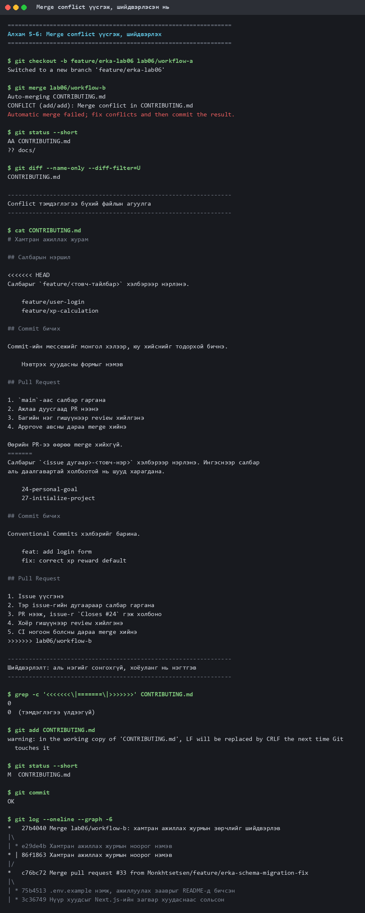

# Лабораторийн ажил №6 — Тайлан

## Git Branching, Merge Conflict шийдвэрлэх, Code Review

| | |
|---|---|
| **Хичээл** | Программ хангамжийн хөгжүүлэлтийн процесс |
| **Долоо хоног** | 6 · CLO4 |
| **Төсөл** | `Monkhtsetsen/Our-New-Web-App` — Goal App |
| **Огноо** | 2026-10-16 |

### Гүйцэтгэсэн баг

| Нэр | Код | Үүрэг |
|---|---|---|
| О.Дэлгэрмаа | B232270024 | Product Owner |
| Т.Мөнхцэцэн | B232270025 | Scrum Master |
| Д.Нурсултан | B232270039 | Хөгжүүлэгч |
| И.Эрдэнэбаяр | B232270136 | Хөгжүүлэгч |

---

## 1. Зорилго

1. Feature branch үүсгэж, ажиллаж, `main` руу нэгтгэх дадлага хийх
2. Санаатайгаар merge conflict үүсгэж, шийдвэрлэх
3. Pull Request үүсгэж, хосоороо code review хийх

---

## 2. Алхам бүрийн гүйцэтгэл

| # | Зааврын алхам | Нотолгоо |
|---|---|---|
| 1 | Хос бүрдүүлэх | Д.Нурсултан — PR [#31](https://github.com/Monkhtsetsen/Our-New-Web-App/pull/31) |
| 2 | Feature branch үүсгэх | `lab06/workflow-a`, `lab06/workflow-b`, `feature/erka-lab06` |
| 3 | Өөрчлөлт, commit | §3 |
| 4 | Pull Request үүсгэх | [#33](https://github.com/Monkhtsetsen/Our-New-Web-App/pull/33), [#34](https://github.com/Monkhtsetsen/Our-New-Web-App/pull/34), энэ PR |
| 5 | Хосоороо conflict үүсгэх | §4 — `CONFLICT (add/add)` |
| 6 | Merge conflict шийдвэрлэх | §5 — merge commit `27b4040` |
| 7 | Code review (2+ тайлбар) | §6 — PR #31 дээр **3 олдвор** |
| 8 | Merge хийх | §7 — PR #33 merge хийгдсэн |

---

## 3. Сонгосон сэдэв: `CONTRIBUTING.md`

Conflict үүсгэхийн тулд утгагүй файл сонгохын оронд багт **үнэхээр дутуу
байсан** зүйлийг сонгов: репод git ажлын урсгалын журам хаана ч бичигдээгүй
байсан.

Хоёр гишүүн ижил файлыг зэрэг бичвэл юу болохыг харуулах нь Лаб 6-гийн
сэдэвтэй шууд нийцнэ.

| Салбар | Санал болгосон журам |
|---|---|
| `lab06/workflow-a` | Салбар `feature/<нэр>` · commit монголоор · 1 approve |
| `lab06/workflow-b` | Салбар `<issue>-<нэр>` · Conventional Commits · 2 approve + CI |

Хоёулаа `main`-ийн ижил цэгээс (`c76bc72`) гарсан.

---

## 4. Алхам 5 — Conflict үүсгэх

```bash
$ git checkout -b feature/erka-lab06 lab06/workflow-a
Switched to a new branch 'feature/erka-lab06'

$ git merge lab06/workflow-b
Auto-merging CONTRIBUTING.md
CONFLICT (add/add): Merge conflict in CONTRIBUTING.md
Automatic merge failed; fix conflicts and then commit the result.

$ git status --short
AA CONTRIBUTING.md
```

`AA` төлөв нь **хоёр тал хоёулаа** тухайн файлыг нэмсэн гэсэн утгатай —
энэ нь `add/add` төрлийн conflict.

### Conflict тэмдэглэгээ

```
<<<<<<< HEAD
Салбарыг `feature/<товч-тайлбар>` хэлбэрээр нэрлэнэ.
...
=======
Салбарыг `<issue дугаар>-<товч-нэр>` хэлбэрээр нэрлэнэ.
...
>>>>>>> lab06/workflow-b
```

| Тэмдэглэгээ | Утга |
|---|---|
| `<<<<<<< HEAD` | Одоогийн салбарын (A) хувилбар эндээс эхэлнэ |
| `=======` | Хоёр хувилбарын зааг |
| `>>>>>>> lab06/workflow-b` | Нэгтгэж буй салбарын (B) хувилбар энд дуусна |

Бүтэн гаралт: [`01-conflict.txt`](01-conflict.txt)



---

## 5. Алхам 6 — Шийдвэрлэх

**Аль нэг талыг бүхэлд нь сонгоогүй.** `git checkout --ours` / `--theirs`
ашиглах нь хамгийн хялбар боловч нөгөө гишүүний бодсон зүйлийг хаяна.
Оронд нь хэсэг тус бүрээр хэлэлцэж нэгтгэв:

| Хэсэг | Шийдвэр | Үндэслэл |
|---|---|---|
| Салбарын нэршил | **Хоёуланг нь** зөвшөөрч, issue байгаа эсэхээр ялгав | Репод аль аль хэлбэр нь аль хэдийн хэрэглэгдсэн (`27-initialize-project`, `feature/user-level-v1`) |
| Commit | Conventional угтвар **+** монгол тайлбар | Угтвар нь `git log` шүүх боломж өгнө, монгол тайлбар бүх гишүүнд ойлгомжтой |
| Review тоо | 2 биш **1** approve | Баг 4 хүнтэй, 2 approve нь хүндрэл үүсгэнэ |
| Нөхөн төлбөр | **CI ногоон** байх шаардлага нэмэв | Автомат шалгалт хоёр дахь ревьюерийн үүргийг хэсэгчлэн гүйцэтгэнэ |

```bash
$ grep -c '<<<<<<<\|=======\|>>>>>>>' CONTRIBUTING.md
0

$ git add CONTRIBUTING.md && git commit
```

Үүссэн merge commit:

```
*   27b4040 Merge lab06/workflow-b: хамтран ажиллах журмын зөрчлийг шийдвэрлэв
|\
| * e29de4b Хамтран ажиллах журмын ноорог нэмэв      (салбар B)
* | 86f1863 Хамтран ажиллах журмын ноорог нэмэв      (салбар A)
|/
*   c76bc72 Merge pull request #33 ...               (нийтлэг эх цэг)
```

Хоёр салаа салж, дахин нийлсэн нь графаас тод харагдана.

---

## 6. Алхам 7 — Code Review

Заавар: *хосоороо нэг нэгнийхээ PR дээр хамгийн багадаа 2 бодит, ашигтай
тайлбар бичих.*

Д.Нурсултаны [PR #31](https://github.com/Monkhtsetsen/Our-New-Web-App/pull/31)
дээр **3 олдвор** бичсэн:

### 1. `tb_` угтвар алга болж байна

| | `tb_` тоо |
|---|---|
| `main` / `schema.ts` | 9 |
| PR #31 / `models.ts` | 0 |

Merge хийвэл `05673cc` commit бүхэлдээ хүчингүй болно.

### 2. `drizzle.config.ts` эвдэрнэ

`schema.ts` → `models.ts` нэр солигдсон ч тохиргоо хуучин замыг заасаар:

```ts
schema: "./src/db/schema.ts",   // PR дээр энэ файл байхгүй
```

`drizzle-kit`-ийн `generate`, `migrate`, `push` бүгд унана.

### 3. Тогтмолууд чимээгүй өөрчлөгдсөн

| | `main` | PR #31 |
|---|---|---|
| `DEFAULT_USER_LEVEL` | `1` | `10` |
| `USER_ROLE_DEFAULT` | `standard_member` | `vip_member` |

Нэг файлын дотор зөрчил ч үүсч байна: `level` багана нь `.default(1)` хэвээр.

> Энэ гурав дахь олдвор нь **Лаб 7-ийн тестийн үндэс болсон.** Ийм алдаа
> дахин гарвал гараар олох шаардлагагүй, CI автоматаар барихаар тест бичив.

---

## 7. Алхам 8 — Merge ба гарсан алдаа

[PR #33](https://github.com/Monkhtsetsen/Our-New-Web-App/pull/33) merge
хийгдэж, 3 commit `main` дээр оров.

### Хийсэн алдаа

PR #33-ыг **өөрөө нээж, өөрөө merge хийсэн** — review: 0, comment: 0.

Энэ нь зааврын 7 → 8 дарааллыг зөрчсөн. Merge хийхээс өмнө review хийлгэх
ёстой байсан.

### Алдаанаас гаргасан дүгнэлт

Яг энэ туршлагаас үүдэн `CONTRIBUTING.md`-д дараах дүрмийг **тодоор**
бичив:

> **Өөрийн PR-ээ өөрөө merge хийхгүй.** Энэ дүрэм хамгийн чухал — merge
> хийхээс өмнө код өөр нэг хүний нүдээр дайрсан байх ёстой.

Алдаа гаргаагүй бол энэ дүрэм зүгээр нэг жагсаалтын мөр болох байсан.
Одоо яагаад хэрэгтэйг нь баг бодитоор мэдэж байна.

Үлдсэн PR-ууд ([#34](https://github.com/Monkhtsetsen/Our-New-Web-App/pull/34)
болон энэ PR) дээр гурван гишүүнээс review хүссэн бөгөөд approve авахаас
өмнө merge хийхгүй.

---

## 8. Үүссэн салбарууд

| Салбар | Зориулалт |
|---|---|
| `lab06/workflow-a` | Conflict-ийн A тал |
| `lab06/workflow-b` | Conflict-ийн B тал |
| `feature/erka-lab06` | Шийдвэрлэлт ба энэ тайлан |
| `feature/erka-schema-migration-fix` | PR #33 — merge хийгдсэн |
| `feature/erka-ci-pipeline` | PR #34 — Лаб 7 |

`lab06/workflow-a` ба `-b` салбаруудыг **устгаагүй** — багшид conflict
үнэхээр хоёр тусдаа салбараас үүссэнийг харуулах нотолгоо болно.

---

## 9. Дүгнэлт

**Conflict бол алдаа биш.** Хоёр хүн зэрэг ажиллавал зайлшгүй гарна. Git
зөвхөн "эндээс эхлээд энд хүртэл хоёр өөр хувилбар байна, аль нь зөвийг
би мэдэхгүй" гэж хэлж байгаа юм.

**Хамгийн хялбар шийдэл хамгийн муу нь байдаг.** `--ours` эсвэл `--theirs`
ашиглавал conflict шууд арилна, гэхдээ нөгөө хүний бодсон зүйл устана. Энэ
лабд хоёр санал хоёулаа үндэслэлтэй байсан — нэгтгэснээр ганцаараа бодсоноос
илүү сайн журам гарсан.

**Хамгийн их сургамж өгсөн зүйл нь зөв хийсэн алхам биш, алдаа байв.**
Өөрийн PR-ээ өөрөө merge хийснээр code review-гийн утга учрыг практикаар
ойлгов — тэр дүрэм одоо багийн журамд бичигдсэн.
