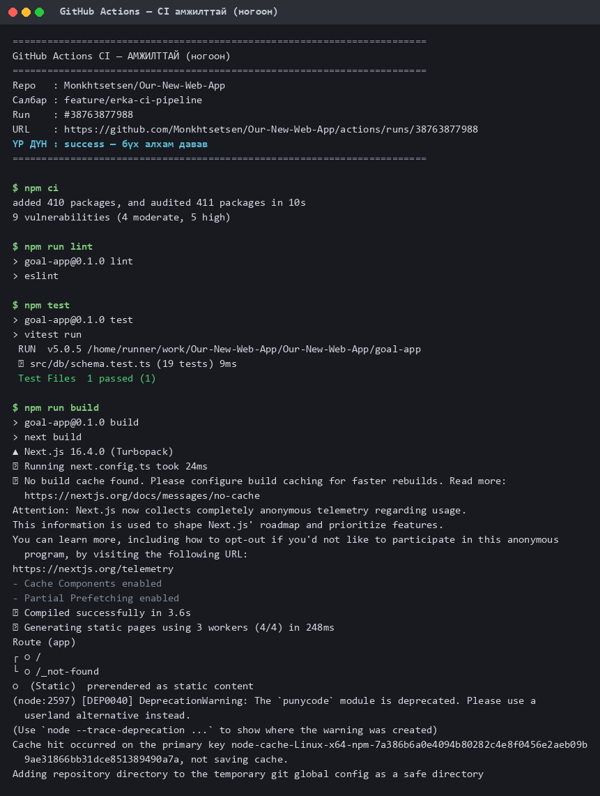
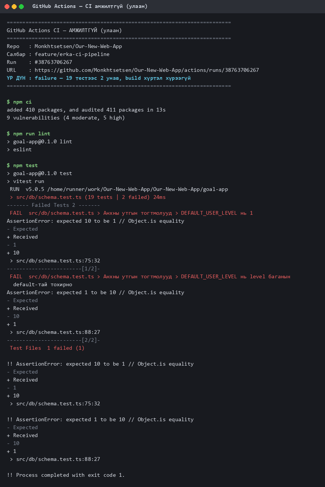

# Лабораторийн ажил №7 — Тайлан

## GitHub Actions ашиглан CI Pipeline байгуулах

| | |
|---|---|
| **Хичээл** | Программ хангамжийн хөгжүүлэлтийн процесс |
| **Долоо хоног** | 7 · CLO4 |
| **Төсөл** | `Monkhtsetsen/Our-New-Web-App` — Goal App |
| **Салбар** | `feature/erka-ci-pipeline` |
| **Pull Request** | [#34](https://github.com/Monkhtsetsen/Our-New-Web-App/pull/34) |
| **Гүйцэтгэсэн** | И.Эрдэнэбаяр /B232270136/ |
| **Огноо** | 2026-10-15 |

---

## 1. Зорилго

1. GitHub Actions workflow файл бие даан бичих
2. Push, Pull Request trigger дээр автомат build/test ажиллуулах
3. CI pipeline-ийн амжилттай/амжилтгүй үр дүнг унших, тайлбарлах

---

## 2. Эхлэх үеийн байдал

Төсөл дээр ямар ч автомат шалгалт байгаагүй:

```
.github/            — байхгүй
goal-app тест       — 0
package.json        — "test" script байхгүй
```

Өөрөөр хэлбэл эвдэрсэн код `main` руу орсон ч хэн ч анзаарахгүй байсан.
Зааврын 5-р алхам `npm test` ажиллуулахыг шаарддаг тул **эхлээд тест бичих
шаардлагатай болсон**.

---

## 3. Нэгж тест бичих

Туршилтын хэрэгслээр **Vitest 5**-ыг сонгов (TypeScript-ийг нэмэлт тохиргоогүй
уншдаг, Next.js-ийн бүтэцтэй зөрчилддөггүй).

`goal-app/src/db/schema.test.ts` — нийт **19 тест**. Drizzle-ийн
`getTableConfig` ашиглан схемийн тогтвортой байдлыг шалгана:

| Бүлэг | Тест | Юу шалгах вэ |
|---|---|---|
| Хүснэгтийн нэршил | 2 | 9 хүснэгт бүгд `tb_` угтвартай, нэрсийн жагсаалт таарч байна |
| Анхны утгууд | 3 | `DEFAULT_USER_LEVEL`, `USER_ROLE_DEFAULT`, тогтмол ↔ баганын default нийцэл |
| `tb_users` | 3 | email давхцахгүй + заавал, xp/streak тэгээс, password_hash заавал |
| `tb_tasks` | 2 | `completed` нь false-аас, `xp_reward` = 10 |
| Enum | 5 | 5 enum-ийн утгууд |
| Түлхүүр, холбоос | 4 | PK байгаа эсэх, `user_id` FK cascade, `task.goal_id` → set null |

### Тестүүд яагаад яг ийм байдлаар сонгогдсон бэ

Санамсаргүй биш. Тухайн үед нээлттэй байсан **PR #31** нь:

- 9 хүснэгтийн `tb_` угтварыг устгаж байсан
- `DEFAULT_USER_LEVEL`-ийг `1` → `10` болгож байсан
- `USER_ROLE_DEFAULT`-ыг `standard_member` → `vip_member` болгож байсан

Эдгээр нь кодыг нүдээр уншиж байж л илэрсэн. **Тест байсан бол автоматаар
баригдах байсан.** Тиймээс тестийг яг тэр гурван зүйлийг хамрахаар бичив.

---

## 4. CI pipeline

`.github/workflows/ci.yml`:

```yaml
name: CI

on:
  push:
    branches: [main]
  pull_request:
    branches: [main]

jobs:
  build-and-test:
    name: Lint, тест, build
    runs-on: ubuntu-latest
    defaults:
      run:
        working-directory: goal-app
    steps:
      - uses: actions/checkout@v5
      - uses: actions/setup-node@v5
        with:
          node-version: 24
          cache: npm
          cache-dependency-path: goal-app/package-lock.json
      - run: npm ci
      - run: npm run lint
      - run: npm test
      - run: npm run build
```

### Онцлох хоёр зүйл

**1. `working-directory`.** Апп нь репозиторийн үндэс дээр биш `goal-app/`
дотор байгаа. `defaults.run.working-directory` заахгүй бол `npm ci` нь
`package.json` олохгүй унана. `cache-dependency-path`-ыг мөн адил зааж өгөх
шаардлагатай.

**2. `npm ci` vs `npm install`.** Заавар `npm install` гэсэн боловч CI-д `npm ci`
илүү тохиромжтой: `package-lock.json`-ыг яг мөрдөж, хувилбар санамсаргүй
өөрчлөгдөхөөс сэргийлдэг бөгөөд хурдан.

---

## 5. Үр дүн — АМЖИЛТТАЙ (ногоон)



Бүтэн лог: [`ci-success.txt`](ci-success.txt) ·
[Run #38763877988](https://github.com/Monkhtsetsen/Our-New-Web-App/actions/runs/38763877988)

```
$ npm ci          added 410 packages, and audited 411 packages in 10s
$ npm run lint    > eslint                       (алдаагүй)
$ npm test        ✓ src/db/schema.test.ts (19 tests) 9ms
                  Test Files  1 passed (1)
$ npm run build   ✓ Compiled successfully in 3.6s
                  ✓ Generating static pages (4/4)
```

---

## 6. Үр дүн — АМЖИЛТГҮЙ (улаан)

Зааврын 8-р алхмын дагуу тестийг **санаатайгаар унагаав**. Санамсаргүй зүйл
сонгоогүй — PR #31 дээр бодитоор хийгдсэн өөрчлөлтийг давтав:

```diff
- export const DEFAULT_USER_LEVEL = 1;
+ export const DEFAULT_USER_LEVEL = 10;
```



Бүтэн лог: [`ci-failure.txt`](ci-failure.txt) ·
[Run #38763706267](https://github.com/Monkhtsetsen/Our-New-Web-App/actions/runs/38763706267)

```
× DEFAULT_USER_LEVEL нь 1
  AssertionError: expected 10 to be 1
  - Expected  1
  + Received  10
  > src/db/schema.test.ts:75:32

× DEFAULT_USER_LEVEL нь level баганын default-тай тохирно
  AssertionError: expected 1 to be 10
  > src/db/schema.test.ts:88:27

Test Files  1 failed (1)
Tests       2 failed | 17 passed (19)
!! Process completed with exit code 1.
```

### Логоос юу уншиж болох вэ

| Ажиглалт | Утга |
|---|---|
| `2 failed \| 17 passed` | Нэг өөрчлөлт **хоёр** тестийг унагаав — тогтмол өөрөө, мөн тогтмол ↔ баганын нийцэл |
| `expected 10 to be 1` | Хүлээж буй ба бодит утга хоёуланг нь шууд харуулна |
| `schema.test.ts:75:32` | Яг аль мөр, аль баганад унасныг зааж өгнө |
| `npm run build` алхам огт **ажиллаагүй** | Тест унаснаар job тэр дор нь зогссон. Алдаатай код build хүртэл хүрэхгүй |
| `exit code 1` | GitHub энэ кодоор ажиллалтыг амжилтгүй гэж үзнэ |

Тестийн нэрийг монгол хэлээр бичсэн тул логоос **юу эвдэрснийг кодыг нээхгүйгээр**
ойлгож болж байна.

---

## 7. Бүрэн мөчлөг

| # | Run | Commit | Үр дүн |
|---|---|---|---|
| 1 | [38763366633](https://github.com/Monkhtsetsen/Our-New-Web-App/actions/runs/38763366633) | CI pipeline нэмсэн | 🟢 success |
| 2 | [38763517481](https://github.com/Monkhtsetsen/Our-New-Web-App/actions/runs/38763517481) | actions v5 болгов | 🟢 success |
| 3 | [38763706267](https://github.com/Monkhtsetsen/Our-New-Web-App/actions/runs/38763706267) | ТУРШИЛТ: санаатайгаар унагаав | 🔴 **failure** |
| 4 | [38763877988](https://github.com/Monkhtsetsen/Our-New-Web-App/actions/runs/38763877988) | ТУРШИЛТ буцаав | 🟢 success |

Эхний ажиллалтад GitHub анхааруулга өгсөн: `actions/checkout@v4` ба
`setup-node@v4` нь Node 20-г зорьдог бөгөөд 2025 оны 9 сараас хуучирсан.
Хоёр дахь commit-оор `v5` болгож анхааруулгыг арилгав.

---

## 8. Хамаарлын шийдвэр

`@types/node`-ийг `^20` → `^24` болгов. Хоёр шалтгаантай:

1. Төсөл **Node 24** дээр ажилладаг атлаа Node 20-ийн тодорхойлолттой байсан
2. Vitest-ийн сүүлийн хувилбар `@types/node@^22 || >=24` шаарддаг

`@types/node@^20` дээр үлдэхийн тулд `vitest@3` ашиглаж үзсэн боловч тэр нь
**2 critical** эмзэг байдал дагуулж байв:

| Багц | Эмзэг байдал |
|---|---|
| `tinypool` | Prototype Pollution → Remote Code Execution |
| `@vitest/mocker` | Path Traversal / Arbitrary File Read |

`vitest@5` сонгосноор critical алга болов. Үлдсэн 5 high нь
`eslint-config-next` → `fast-glob` → `micromatch` → `braces` гинжнээс ирж
байгаа, энэ ажлаас үүдээгүй (Лаб 11-ийн сэдэв).

---

## 9. Гүйцэтгэлийн шалгуурын хяналт

| Зааврын шаардлага | Төлөв | Нотолгоо |
|---|---|---|
| `.github/workflows/` хавтас | ✅ | [`ci.yml`](../../.github/workflows/ci.yml) |
| `name`, `on: [push, pull_request]`, `jobs` | ✅ | ci.yml:1-10 |
| `actions/checkout` | ✅ | ci.yml — `@v5` |
| Орчны тохиргоо (`setup-node`) | ✅ | ci.yml — `@v5`, Node 24 |
| Install алхам | ✅ | `npm ci` |
| Test алхам | ✅ | `npm test` → 19 тест |
| Push/PR trigger-тэй | ✅ | 4 ажиллалт PR дээр автоматаар эхэлсэн |
| Амжилттай ажилласан нотолгоо | ✅ | §5, run #38763877988 |
| Санаатайгаар унагаасан нотолгоо | ✅ | §6, run #38763706267 |
| Юу болсныг тайлбарласан | ✅ | §6 "Логоос юу уншиж болох вэ" |

---

## 10. Дүгнэлт

CI байгуулахын өмнө баг `main` руу орсон кодын зөв эсэхийг **зөвхөн гараар**
шалгаж байсан. Бодит жишээ: PR #31 дээр `DEFAULT_USER_LEVEL` 1-ээс 10 болж
өөрчлөгдсөн нь кодыг мөр мөрөөр уншиж байж л илэрсэн. Хэрэв анзаарагдалгүй
merge хийгдсэн бол шинэ бүртгүүлсэн хэрэглэгч бүр 10-р түвшнээс эхлэх байв.

Одоо тэр ижил өөрчлөлт **32 секундын дотор автоматаар улаан** болж байна.

Хамгийн чухал ажиглалт: **CI нь тесттэйгээ л хэрэгтэй.** Хэрэв `npm test`
алхам байсан ч тест нь нэг ч байгаагүй бол pipeline үргэлж ногоон байж,
хуурамч итгэл төрүүлэх байсан. Тиймээс энэ лабын ажлын хагас нь тест бичих
байв.

Дараагийн алхам (Лаб 10): `npm audit`-ийн үлдсэн 5 high-г шийдэх, мөн
бизнес логик (XP тооцоолол, streak) бичигдэх үед түүнд нь тест нэмэх.
